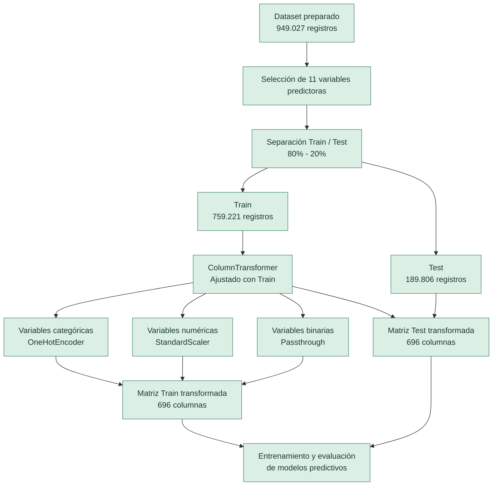
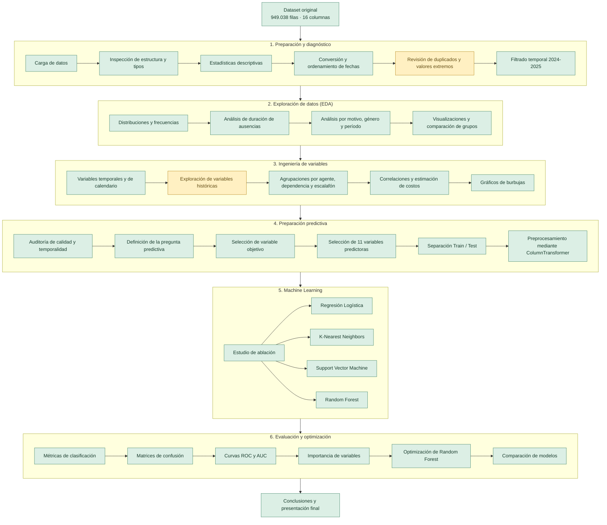

# Data Science Project: Análisis y Predicción de Ausentismo en la Administración Pública


Este repositorio contiene un proyecto end-to-end de Ciencia de Datos orientado al Análisis Exploratorio de Datos (EDA) y la Modelación Predictiva del Ausentismo Laboral en el ámbito de la Administración Pública.

A través del procesamiento y la ingeniería de características (Feature Engineering) sobre registros masivos de licencias correspondientes al período 2024-2025, el proyecto busca identificar patrones clave de ausentismo, analizar su comportamiento temporal y explorar la relación entre las características de los agentes, las dependencias y los distintos motivos de ausencia.

En la etapa de Machine Learning, se desarrollan y comparan modelos de clasificación supervisada cuyo objetivo es predecir si una ausencia registrada corresponde a una licencia por motivos de Salud o No Salud, utilizando variables laborales, demográficas y temporales.

El proyecto integra las etapas de limpieza y preparación de datos, análisis exploratorio, ingeniería de características, preprocesamiento, entrenamiento, evaluación y comparación de modelos predictivos.

Asimismo, se incorporan estudios de ablación de variables, análisis de importancia de características, optimización de hiperparámetros y evaluación mediante métricas de clasificación y curvas ROC-AUC, con el propósito de identificar modelos con un adecuado equilibrio entre desempeño predictivo, interpretabilidad y costo computacional.

---

## 🚀 Estado del Proyecto

**Cuarta preentrega - Proyecto finalizado**

El proyecto integra un flujo de trabajo end-to-end de Ciencia de Datos, desde la preparación y exploración de los datos hasta la construcción, optimización y evaluación de modelos de Machine Learning.

### 📋 Etapas del Proyecto

- [x] Limpieza y preparación del dataset.
- [x] Análisis exploratorio de datos (EDA).
- [x] Ingeniería de características (Feature Engineering).
- [x] Definición de la variable objetivo.
- [x] Preprocesamiento de variables numéricas, categóricas y binarias.
- [x] Estudio de ablación de la remuneración mensual.
- [x] Implementación de modelos de clasificación supervisada.
- [x] Análisis de importancia de variables mediante Random Forest.
- [x] Evaluación de modelos mediante métricas de clasificación.
- [x] Comparación de modelos predictivos.
- [x] Evaluación mediante curvas ROC y métricas AUC.
- [x] Optimización de hiperparámetros de Random Forest.
- [x] Selección y evaluación del modelo definitivo.
- [x] Elaboración de conclusiones finales.
- [x] Documentación del proyecto y actualización del repositorio.

---

## 👥 Equipo de trabajo Nro 15

### Sobre Nosotros

#### Fabiana Winterstetter

Soy ingeniera en sistemas y desde hace 30 años trabajo en una empresa en la que nos dedicamos a hacer sistemas para gestión financiera y de RRHH en la Administración Pública.

Siempre me gustaron los desafíos y mi curiosidad es interminable, a pesar de los años que han pasado de carrera siempre quiero aprender cosas nuevas. Empecé con Análisis de Datos y me anoté en este curso para dar el siguiente paso.

#### Nicolás Germán Diaz

Soy Técnico electrónico, actualmente me desempeño en el área de Calidad en una empresa ferroviaria. Entusiasta de la tecnología y de las nuevas herramientas. Trato de conocer más de los temas que me interesan, en los últimos años realicé cursos de programación, base de datos, automatización con n8n y ahora me encuentro realizando este curso de Data Science. Creo que es importante actualizarse, desarrollar nuevas habilidades y siempre seguir aprendiendo.

---

## 📋 Tabla de Contenidos

- [Descripción del Dataset](#descripción-del-dataset)
- [Objetivos del Proyecto](#objetivos-del-proyecto)
- [Análisis Exploratorio de Datos (EDA)](#análisis-exploratorio-de-datos-eda)
- [Ingeniería de Variables (Feature Engineering)](#ingeniería-de-variables-feature-engineering)
- [Definición de la Variable Objetivo](#definición-de-la-variable-objetivo)
- [Preparación y Preprocesamiento](#preparación-y-preprocesamiento)
- [Estudio de Ablación](#estudio-de-ablación)
- [Modelos Predictivos](#modelos-predictivos)
- [Evaluación y Comparación de Modelos](#evaluación-y-comparación-de-modelos)
- [Importancia de Variables](#importancia-de-variables)
- [Optimización de Random Forest](#optimización-de-random-forest)
- [Flujo de Trabajo](#flujo-de-trabajo)
- [Estado de las Etapas Realizadas](#estado-de-las-etapas-realizadas)
- [Controles de Calidad y Limitaciones](#controles-de-calidad-y-limitaciones)
- [Conclusiones](#conclusiones)
- [Tecnologías Utilizadas](#tecnologías-utilizadas)

---

## 📊 Descripción del Dataset

Este dataset contiene datos sobre el ausentismo (faltas) en la Administración Pública de una provincia Argentina.

Por razones de confidencialidad no se dan mayores datos sobre la provincia a la que pertenecen los datos, ya que los mismos se obtuvieron del sistema de registración de faltas y novedades.

El conjunto de datos obtenido se almacenó en un archivo CSV (`prueba2025_c.csv`).

El dataset original contiene **949.038 registros históricos de licencias y ausencias de agentes públicos**, distribuidos en 16 variables originales.

### Características del Dataset

| Característica | Descripción |
|---|---|
| Archivo original | `prueba2025_c.csv` |
| Registros originales | 949.038 |
| Variables originales | 16 |
| Período seleccionado | 2024-2025 |
| Registros excluidos por fecha de inicio | 11 |
| Registros del período analizado | 949.027 |
| Unidad de análisis | Registro individual de ausencia o licencia |
| Tipo de información | Laboral, administrativa, demográfica y temporal |

### Diccionario de Variables

| Variable | Descripción |
|---|---|
| `nro_legajo` | Identificador del agente o empleado. |
| `escalafon` | Agrupamiento o carrera dentro de la Administración Pública. |
| `categoria` | Categoría o clase dentro del escalafón de la Administración Pública. |
| `cod_art_ausencia` | Código del artículo de la licencia según la normativa laboral. |
| `descripcion_articulo_ausencia` | Detalle o motivo de la ausencia (ej. Enfermedad Común, Razones Particulares). |
| `es_de_salud` | Indicador categórico (`yes` / `no`) para licencias de índole médica. |
| `fecha_desde` | Fecha de inicio de la ausencia. |
| `fecha_hasta` | Fecha de finalización de la ausencia. |
| `cantidad_dias` | Cantidad de días de duración de la ausencia. |
| `cant_dias_permitido_mes` | Límite normativo de días permitidos por mes. |
| `cantidad_dias_permitido_año` | Límite normativo de días permitidos por año. |
| `dependencia` | Oficina, organismo o área de trabajo del agente. |
| `anio_nacimiento` | Año de nacimiento del agente. |
| `genero` | Género registrado del agente. |
| `antiguedad` | Años de servicio prestados por el agente. |
| `remuneracion_mensual` | Remuneración mensual registrada del agente. |

### 📅 Delimitación Temporal

Durante la preparación del dataset se identificaron registros cuya fecha de inicio se encontraba fuera del período de análisis seleccionado.

Con el objetivo de trabajar sobre un marco temporal consistente, se conservaron las ausencias iniciadas entre el 1 de enero de 2024 y el 31 de diciembre de 2025.

| Año de inicio | Cantidad de registros |
|---|---:|
| 2024 | 463.024 |
| 2025 | 486.003 |
| **Total** | **949.027** |

Se excluyeron 11 registros correspondientes a fechas de inicio fuera del período seleccionado.

El criterio de filtrado se aplicó sobre la fecha de inicio de la ausencia (`fecha_desde`). Por lo tanto, una licencia iniciada dentro del período puede finalizar posteriormente sin que esto implique necesariamente un error.

---

## 🎯 Objetivos del Proyecto

### 1. Análisis Exploratorio de Datos (EDA)

Identificar la estacionalidad, los artículos de licencia más solicitados y las características del ausentismo según rango etario, género, antigüedad, escalafón y dependencia.

Analizar la distribución de las ausencias, su duración y su relación con diferentes características laborales y temporales.

### 2. Feature Engineering Temporal y Acumulado

Derivar variables continuas, categóricas y binarias a partir de los registros de ausencias.

Explorar variables históricas, agrupaciones y características temporales que permitan enriquecer el análisis y construir una matriz de datos adecuada para Machine Learning.

### 3. Predicción de Licencias por Salud o No Salud

Desarrollar modelos de clasificación supervisada capaces de estimar si una ausencia iniciada en determinado día corresponde a una licencia por motivos de Salud o No Salud.

### 4. Comparación de Modelos Predictivos

Entrenar y evaluar diferentes algoritmos de Machine Learning para identificar sus fortalezas, limitaciones y desempeño sobre el problema de clasificación planteado.

### 5. Optimización e Interpretación

Analizar la importancia de las variables predictoras, evaluar el aporte de la remuneración mensual y estudiar configuraciones de hiperparámetros que permitan mejorar el rendimiento de los modelos.

> **Alcance predictivo:** el proyecto clasifica el tipo de una ausencia registrada. No busca predecir directamente si un agente se ausentará, cuántos días faltará ni su riesgo individual de ausentismo.

---

## 🔎 Análisis Exploratorio de Datos (EDA)

El análisis exploratorio constituye la primera etapa del proyecto y permite comprender la estructura, distribución y comportamiento de los datos antes de construir los modelos predictivos.

### Distribución de la duración de las ausencias

Según las estadísticas descriptivas del dataset original:

| Indicador | Valor |
|---|---:|
| Cantidad de registros | 949.038 |
| Duración media | 4,28 días |
| Mediana | 1 día |
| Percentil 75 | 3 días |
| Duración máxima registrada | 1.357 días |
| Filas duplicadas detectadas | 2.211 |
| Porcentaje de filas duplicadas | 0,23 % |

La diferencia entre la media y la mediana indica que la distribución de la duración está sesgada hacia valores altos.

La mayoría de los registros corresponde a duraciones cortas, mientras que algunos registros presentan duraciones muy prolongadas.

**Comentario:** los valores extremos deben investigarse antes de decidir si se conservan, corrigen o excluyen. No deben eliminarse automáticamente, porque podrían representar situaciones administrativas válidas.

### Variables temporales

Se generaron variables derivadas de las fechas, como:

- Edad aproximada del agente.
- Mes de inicio de la ausencia.
- Trimestre.
- Día de la semana.
- Indicadores asociados a fines de semana, feriados o días puente.
- Indicadores de estacionalidad invernal.

### Análisis del efecto puente

Se estudió la relación entre el inicio de las ausencias y los días próximos a fines de semana y feriados.

Para ello, se construyó una variable que identifica ausencias iniciadas en días lunes, viernes o días adyacentes a feriados, de acuerdo con el criterio de calendario definido en la notebook.

| Indicador | Resultado |
|---|---:|
| Registros del período analizado | 949.027 |
| Ausencias iniciadas en días considerados puente | 464.076 |
| Porcentaje sobre el total | 48,90 % |

Al analizar algunos artículos de licencia, se observaron diferencias en la proporción de ausencias iniciadas en días considerados puente.

| Tipo de licencia | Porcentaje de inicio en días puente |
|---|---:|
| Razones Particulares | 60,27 % |
| Permiso Gremial | 60,98 % |
| Enfermedad Común | 45,91 % |
| Enfermedad Prolongada | 37,68 % |

Estos resultados permiten identificar patrones temporales diferenciados entre los tipos de licencia.

**Comentario:** la asociación con determinados días del calendario no demuestra causalidad ni permite concluir que una ausencia individual sea injustificada.

### Variables históricas

El análisis contempla variables relacionadas con el historial de ausencias de cada agente, entre ellas:

- Cantidad de ausencias anteriores.
- Días de ausencia acumulados.
- Tiempo transcurrido desde una ausencia previa.
- Uso de días permitidos, cuando corresponda.

**Comentario:** estas variables necesitan una revisión temporal específica. Los cálculos deben utilizar solamente registros anteriores al evento que se desea predecir.

Además, si un acumulado representa días consumidos durante un año, debe verificarse que se reinicie al cambiar el año y que no incluya información futura.

Por este motivo, las variables históricas acumuladas no forman parte del conjunto de 11 predictores utilizado en los modelos principales de clasificación.

### Agrupaciones y gráficos de burbujas

Se realizaron comparaciones por dependencia y escalafón utilizando indicadores como:

- Antigüedad promedio.
- Duración promedio de las ausencias.
- Cantidad de registros.
- Distribución por género e índice de género.

Los gráficos de burbujas permiten representar simultáneamente diferentes dimensiones del análisis, facilitando la identificación de grupos con características particulares.

**Comentario:** los gráficos permiten identificar diferencias entre grupos, pero no demuestran causalidad.

Tampoco permiten estimar directamente una tasa de ausentismo de la dotación laboral si no se dispone de información sobre la cantidad de trabajadores que integran cada grupo.

### Análisis de agrupamientos

Como complemento del análisis exploratorio, se estudió la construcción de perfiles de dependencias a partir de indicadores agregados, tales como:

- Cantidad de registros de ausencia.
- Duración media de las ausencias.
- Antigüedad media de los agentes asociados a los registros.

Se exploró el algoritmo K-Means para identificar grupos de dependencias con características similares, utilizando estandarización de variables y criterios de evaluación como la inercia y el coeficiente de Silhouette.

Este análisis corresponde a una etapa exploratoria de aprendizaje no supervisado y se diferencia del objetivo principal de clasificación Salud / No Salud.

---

## 💡 Ingeniería de Variables (Feature Engineering)

El pipeline de preparación transforma el dataset original agregando nuevas dimensiones de análisis.

### Variables Temporales y Estacionales

| Variable | Descripción |
|---|---|
| `edad_agente` | Edad aproximada del agente al momento del evento, calculada a partir del año de nacimiento. |
| `mes_inicio` | Mes en el que comienza la ausencia. |
| `trimestre` | Trimestre del año correspondiente al inicio de la ausencia. |
| `dia_semana_inicio_num` | Día de la semana de inicio representado numéricamente. |
| `es_feriado` | Indicador de inicio en un día feriado. |
| `es_dia_sandwich` | Indicador de inicio en un día considerado puente, según el criterio definido en el análisis. |
| `es_invierno_num` | Indicador de estacionalidad invernal. |

### Variables seleccionadas para el modelado

Para la construcción de los modelos de clasificación se seleccionaron 11 variables predictoras.

| Tipo de variable | Variables seleccionadas |
|---|---|
| Categóricas | `escalafon`, `categoria`, `dependencia` |
| Numéricas | `antiguedad`, `edad_agente`, `mes_inicio`, `dia_semana_inicio_num`, `remuneracion_mensual` |
| Binarias | `es_feriado`, `es_dia_sandwich`, `es_invierno_num` |

### Matriz de Variables Predictoras

```python
features = [
    "escalafon",
    "categoria",
    "dependencia",
    "antiguedad",
    "edad_agente",
    "mes_inicio",
    "dia_semana_inicio_num",
    "remuneracion_mensual",
    "es_feriado",
    "es_dia_sandwich",
    "es_invierno_num"
]
```

### Criterio de selección

Se seleccionaron variables que describen características laborales, demográficas y temporales asociadas a la ausencia.

Se excluyeron de la matriz predictiva aquellas variables que identifican directamente el motivo de la licencia o que podrían contener información conocida posteriormente al momento de inicio de la ausencia.

Entre ellas:

- Código del artículo de ausencia.
- Descripción del artículo de ausencia.
- Indicador original `es_de_salud`.
- Fecha de finalización de la ausencia.
- Cantidad de días de duración de la ausencia.
- Límites normativos asociados al tipo de licencia.
- Identificador del agente.
- Variables históricas acumuladas sin validación temporal específica.

La exclusión de estas variables busca reducir el riesgo de fuga de información (Data Leakage).

---

## 🎯 Definición de la Variable Objetivo

El problema de Machine Learning se formuló como una tarea de clasificación binaria supervisada.

La variable objetivo se construyó a partir del campo original `es_de_salud`.

### Codificación del Target

| Clase | Valor original | Descripción |
|---|---|---|
| 0 | `no` | Licencias por motivos No Salud |
| 1 | `yes` | Licencias por motivos de Salud |

```python
assert df_ausentismo_ord["es_de_salud"].isin(
    ["yes", "no"]
).all()

df_ausentismo_ord["target"] = (
    df_ausentismo_ord["es_de_salud"] == "yes"
).astype(int)
```

### Distribución de la Variable Objetivo

| Clase | Cantidad de registros | Porcentaje |
|---|---:|---:|
| No Salud (0) | 407.430 | 42,93 % |
| Salud (1) | 541.597 | 57,07 % |
| **Total** | **949.027** | **100 %** |

La distribución presenta una mayor proporción de licencias por motivos de Salud, aunque ambas clases cuentan con una representación considerable dentro del dataset.

La clase No Salud incluye todas las licencias identificadas como `no`, no solamente Razones Particulares o Permisos Gremiales.

### Pregunta predictiva

> Dadas las características laborales, demográficas y temporales disponibles de una ausencia, ¿es posible clasificarla como una licencia por motivos de Salud o No Salud?

---

## ⚙️ Preparación y Preprocesamiento

La preparación de los datos para Machine Learning se realizó mediante herramientas de Scikit-learn, diferenciando el tratamiento de las variables categóricas, numéricas y binarias.

### Separación de los datos

El dataset se dividió en conjuntos de entrenamiento y prueba utilizando una separación estratificada.

| Conjunto | Cantidad de registros | Proporción |
|---|---:|---:|
| Entrenamiento (Train) | 759.221 | 80 % |
| Prueba (Test) | 189.806 | 20 % |
| **Total** | **949.027** | **100 %** |

La estratificación permite conservar una proporción similar de las clases Salud y No Salud en ambos conjuntos.

```python
X_train, X_test, y_train, y_test = train_test_split(
    X,
    y,
    test_size=0.20,
    random_state=42,
    stratify=y
)
```

### Tratamiento de Variables

| Tipo de variable | Transformación | Objetivo |
|---|---|---|
| Categóricas | OneHotEncoder | Representar categorías sin asignarles un orden numérico artificial. |
| Numéricas | StandardScaler | Estandarizar las variables y reducir diferencias de escala. |
| Binarias | Passthrough | Conservar los indicadores originales 0 y 1. |

### ColumnTransformer

Se utilizó `ColumnTransformer` para aplicar transformaciones diferenciadas sobre cada grupo de variables.

```python
preprocesador = ColumnTransformer(
    transformers=[
        (
            "categoricas",
            OneHotEncoder(
                handle_unknown="ignore",
                sparse_output=True
            ),
            variables_categoricas
        ),
        (
            "numericas",
            StandardScaler(),
            variables_numericas
        ),
        (
            "binarias",
            "passthrough",
            variables_binarias
        )
    ],
    sparse_threshold=1.0,
    remainder="drop"
)
```

El preprocesador se ajustó exclusivamente con el conjunto de entrenamiento y posteriormente se aplicó al conjunto de prueba.

```python
X_train_esc = preprocesador.fit_transform(X_train)

X_test_esc = preprocesador.transform(X_test)
```

Este procedimiento evita que los parámetros del preprocesamiento se calculen utilizando información del conjunto de prueba.

### Dimensiones de la Matriz Transformada

| Conjunto | Filas | Variables originales | Columnas transformadas |
|---|---:|---:|---:|
| Train | 759.221 | 11 | 696 |
| Test | 189.806 | 11 | 696 |

La expansión de 11 variables originales a 696 columnas se debe principalmente a la codificación One-Hot de las variables categóricas.

Se utilizaron matrices dispersas (Sparse Matrices) para optimizar el uso de memoria.

### Esquema de Preprocesamiento



---

## 🧪 Estudio de Ablación

Durante la etapa de modelado se realizó un estudio de ablación para evaluar el aporte de la variable `remuneracion_mensual`.

El objetivo fue determinar si la inclusión de esta variable mejora el desempeño predictivo y analizar su posible relación con el riesgo de fuga de información.

### Metodología

Se compararon dos configuraciones de Regresión Logística:

- **Modelo A:** incluye la variable `remuneracion_mensual`.
- **Modelo B:** excluye la variable `remuneracion_mensual`.

Para garantizar una comparación consistente, ambos modelos utilizaron los mismos registros de entrenamiento y validación.

| Conjunto experimental | Cantidad de registros |
|---|---:|
| Entrenamiento | 607.376 |
| Validación | 151.845 |
| Total del conjunto de entrenamiento original | 759.221 |

Cada configuración contó con su propio preprocesador, ajustado exclusivamente sobre el conjunto de entrenamiento experimental.

El conjunto de Test general no se utilizó para seleccionar entre las dos configuraciones del estudio de ablación.

### Resultados del Estudio de Ablación

| Métrica | Con remuneración | Sin remuneración |
|---|---:|---:|
| Accuracy | 0,7989 | 0,7958 |
| Precision | 0,7939 | 0,7829 |
| Recall | 0,8747 | 0,8887 |
| F1 Score | 0,8324 | 0,8324 |
| ROC-AUC | 0,8742 | 0,8495 |

### Interpretación de los Resultados

La inclusión de la remuneración mensual presenta una mejora en Accuracy, Precision y ROC-AUC.

Por otro lado, el modelo sin remuneración obtiene un Recall superior, mientras que el F1 Score permanece prácticamente constante.

La diferencia en ROC-AUC es de aproximadamente 0,0247, lo que indica que la remuneración mensual aporta capacidad de discriminación entre las clases Salud y No Salud bajo las condiciones del experimento.

### Decisión Metodológica

Se decidió conservar la variable `remuneracion_mensual` dentro del conjunto de 11 variables predictoras.

Esta decisión se fundamenta en su aporte predictivo y en el supuesto de que representa la remuneración mensual habitual del agente, independientemente de las ausencias registradas.

**Limitación:** el estudio de ablación no demuestra por sí mismo la ausencia de fuga de información. La procedencia administrativa de la remuneración y su disponibilidad al momento de realizar la predicción requieren una validación adicional.

---

## 🤖 Modelos Predictivos

Se desarrollaron cuatro modelos de clasificación supervisada con el objetivo de comparar diferentes enfoques de Machine Learning.

### 1. Regresión Logística (Logistic Regression)

Modelo de clasificación utilizado como referencia inicial (Baseline).

Permite estimar la probabilidad de pertenencia a la clase Salud a partir de una combinación de las variables predictoras.

**Características principales:**

- Modelo lineal de clasificación.
- Interpretación relativamente sencilla.
- Bajo costo computacional en comparación con otros algoritmos.
- Referencia para evaluar el aporte de modelos más complejos.

### 2. K-Nearest Neighbors (KNN)

Modelo de clasificación basado en la similitud entre registros.

El algoritmo identifica los vecinos más cercanos de cada observación y determina la clase mediante la distribución de clases de dichos vecinos.

**Configuración de referencia:**

```python
modelo_knn = KNeighborsClassifier(
    n_neighbors=5
)
```

**Características principales:**

- Clasificación basada en proximidad.
- Sensibilidad a la escala de las variables.
- Capacidad para representar relaciones no lineales.
- Costo computacional elevado durante la predicción sobre grandes volúmenes de datos.

La estandarización de las variables numéricas constituye una etapa importante para este modelo.

Las probabilidades se obtienen mediante `predict_proba()` y se utilizan tanto para construir las predicciones como para evaluar la curva ROC.

### 3. Support Vector Machine (SVM)

Modelo de clasificación basado en la construcción de una frontera de decisión que busca separar las clases.

Se utilizó un kernel RBF (Radial Basis Function), que permite representar relaciones no lineales.

**Configuración de referencia:**

```python
modelo_svm = SVC(
    kernel="rbf",
    random_state=42
)
```

Debido al volumen del dataset y al costo computacional del algoritmo, se utilizaron muestras estratificadas para el entrenamiento y la evaluación.

| Conjunto | Registros utilizados | Porcentaje del conjunto completo |
|---|---:|---:|
| Train | 15.000 | 1,98 % |
| Test | 15.000 | 7,90 % |

Para la construcción de la curva ROC se utilizaron los valores obtenidos mediante `decision_function()`.

**Limitación:** los resultados de SVM no constituyen una comparación completamente equivalente con los modelos entrenados y evaluados sobre los conjuntos completos.

### 4. Random Forest

Modelo de aprendizaje supervisado basado en un conjunto de árboles de decisión.

Cada árbol participa en la clasificación y el modelo combina sus resultados para obtener una predicción final.

**Configuración inicial de referencia:**

```python
modelo_rf = RandomForestClassifier(
    n_estimators=100,
    max_depth=12,
    random_state=42
)
```

**Características principales:**

- Capacidad para representar relaciones no lineales.
- Combinación de múltiples árboles de decisión.
- Posibilidad de analizar la importancia de las variables.
- Capacidad de ajustar la complejidad mediante hiperparámetros.
- Posibilidad de mejorar el equilibrio entre rendimiento predictivo y generalización.

La configuración inicial constituye el punto de partida para el análisis de optimización de hiperparámetros.

---

## 📈 Evaluación y Comparación de Modelos

La evaluación se realizó mediante diferentes métricas de clasificación, considerando la clase Salud como clase positiva.

### Métricas utilizadas

| Métrica | Descripción |
|---|---|
| Accuracy | Proporción de predicciones correctas sobre el total de registros evaluados. |
| Precision | Proporción de predicciones de Salud que corresponden efectivamente a licencias de Salud. |
| Recall | Proporción de licencias de Salud correctamente identificadas por el modelo. |
| F1 Score | Media armónica entre Precision y Recall. |
| ROC-AUC | Capacidad del modelo para discriminar entre las clases Salud y No Salud a través de diferentes umbrales. |

### Matriz de Confusión

La matriz de confusión permite identificar los aciertos y errores del modelo para cada clase.

| | Predicción No Salud | Predicción Salud |
|---|---|---|
| Real No Salud | Verdaderos Negativos (VN) | Falsos Positivos (FP) |
| Real Salud | Falsos Negativos (FN) | Verdaderos Positivos (VP) |

La interpretación de los errores depende del objetivo del modelo y de las consecuencias asociadas a una clasificación incorrecta.

### Resultados de la Tercera Preentrega

Se conservaron los resultados históricos de la tercera preentrega como referencia de la evolución del proyecto.

| Modelo | Accuracy histórico |
|---|---:|
| Regresión Logística | 76,98 % |
| KNN | 83,78 % |
| Random Forest | 86,43 % |
| SVM | 82,55 % |

Estos resultados corresponden a una configuración anterior del problema, las variables predictoras y el preprocesamiento.

Por lo tanto, se presentan exclusivamente como referencia histórica y no deben interpretarse como una comparación controlada del rendimiento de los algoritmos.

### Resultados de la Cuarta Preentrega

La siguiente tabla presenta los resultados de referencia obtenidos con la definición actualizada del target y el preprocesamiento de las 11 variables predictoras, antes de incorporar los resultados de la optimización final de Random Forest.

| Modelo | Accuracy | Precision | Recall | F1 Score |
|---|---:|---:|---:|---:|
| Regresión Logística | 79,76 % | 79,33 % | 87,28 % | 83,11 % |
| KNN (k=5) | 83,03 % | 85,03 % | 85,27 % | 85,15 % |
| Random Forest | 79,43 % | 77,81 % | 89,47 % | 83,23 % |
| SVM (RBF)* | 79,81 % | 78,89 % | 88,21 % | 83,29 % |

\* SVM se entrenó y evaluó utilizando muestras estratificadas de 15.000 registros. Los demás modelos utilizaron los conjuntos completos de entrenamiento y prueba.

### Interpretación de los Resultados

KNN presenta el mayor Accuracy, Precision y F1 Score entre las configuraciones de referencia evaluadas sobre el conjunto completo de prueba.

Random Forest presenta un Recall superior, lo que indica una mayor capacidad para identificar las licencias de Salud, aunque con una menor Precision.

Regresión Logística ofrece un desempeño competitivo considerando su menor complejidad y constituye una referencia relevante para evaluar los modelos no lineales.

SVM presenta resultados similares a los obtenidos por Regresión Logística y Random Forest, aunque su evaluación se realizó sobre una muestra reducida.

La comparación entre modelos debe considerar no solamente las métricas de clasificación, sino también el tiempo de entrenamiento, el tiempo de predicción, la interpretabilidad y las condiciones de evaluación.

### Curvas ROC y AUC

La curva ROC (Receiver Operating Characteristic) permite evaluar el comportamiento de un modelo de clasificación a través de diferentes umbrales de decisión.

En el eje horizontal se representa la tasa de falsos positivos (False Positive Rate), mientras que en el eje vertical se representa la tasa de verdaderos positivos (True Positive Rate).

El área bajo la curva (AUC) resume la capacidad de discriminación del modelo entre las clases.

| Modelo | Valores utilizados para ROC |
|---|---|
| Regresión Logística | Probabilidades de la clase Salud mediante `predict_proba()`. |
| KNN | Probabilidades de la clase Salud mediante `predict_proba()`. |
| Random Forest | Probabilidades de la clase Salud mediante `predict_proba()`. |
| SVM | Valores de la función de decisión mediante `decision_function()`. |

Las curvas ROC complementan las métricas calculadas para un umbral específico y permiten analizar la capacidad de discriminación de los modelos.

La evaluación utiliza los valores continuos de probabilidad o decisión, no las etiquetas de clase predichas.

Los valores de ROC-AUC y los gráficos correspondientes se documentan en la notebook de análisis y modelado.

**Consideración metodológica:** la curva ROC de SVM corresponde a una muestra de evaluación diferente en tamaño respecto de los otros modelos, por lo que su comparación debe interpretarse teniendo en cuenta esta limitación.

---

## 🌳 Importancia de Variables

Se utilizó Random Forest para analizar la contribución relativa de las variables predictoras al proceso de clasificación.

Debido a la aplicación de OneHotEncoder, las 11 variables originales se transformaron en 696 columnas.

Por este motivo, el análisis de importancia se realizó en dos niveles:

1. Importancia individual de cada columna transformada.
2. Importancia agrupada por variable original.

### Procedimiento

- Obtener los nombres de las columnas transformadas mediante `get_feature_names_out()`.
- Recuperar las importancias del modelo mediante `feature_importances_`.
- Asociar cada columna transformada con su variable original.
- Agrupar y sumar las importancias de las categorías correspondientes a cada variable.
- Validar la cantidad de variables agrupadas y la suma total de las importancias.

### Resultado del Agrupamiento

| Indicador | Resultado |
|---|---:|
| Variables predictoras originales | 11 |
| Columnas transformadas | 696 |
| Variables agrupadas para interpretación | 11 |
| Suma de las importancias | 1,00 |

En la configuración inicial de Random Forest, la remuneración mensual presenta una participación aproximada del 27,12 % de la importancia total.

Este resultado es consistente con el interés de evaluar el aporte de dicha variable mediante el estudio de ablación.

### Consideraciones

La importancia de variables de Random Forest permite identificar cuáles son las características que más contribuyen a las divisiones de los árboles.

Sin embargo:

- No demuestra relaciones causales.
- Puede favorecer variables con determinadas características o cardinalidades.
- Depende de la configuración del modelo.
- No constituye por sí sola una prueba de ausencia de fuga de información.

---

## 🔧 Optimización de Random Forest

Como parte del proceso de mejora de los modelos, se incorpora el análisis de hiperparámetros de Random Forest.

El objetivo es identificar una configuración que permita mejorar el desempeño predictivo respecto de la configuración inicial, manteniendo un equilibrio adecuado entre complejidad, capacidad de generalización y costo computacional.

### Hiperparámetros de Interés

| Hiperparámetro | Descripción |
|---|---|
| `n_estimators` | Cantidad de árboles que componen el bosque. |
| `max_depth` | Profundidad máxima permitida para cada árbol. |
| `min_samples_split` | Cantidad mínima de registros necesaria para dividir un nodo. |
| `min_samples_leaf` | Cantidad mínima de registros que debe contener una hoja. |
| `max_features` | Cantidad de características consideradas al buscar una división. |
| `class_weight` | Ponderación de las clases durante el entrenamiento. |

### Metodología de Optimización

La optimización se plantea como una comparación de configuraciones de hiperparámetros mediante una estrategia de búsqueda y validación dentro del conjunto de entrenamiento.

El preprocesamiento debe ajustarse utilizando únicamente los datos de entrenamiento correspondientes a cada partición de validación.

Se consideran las siguientes etapas:

1. Establecer la configuración inicial de Random Forest como referencia.
2. Evaluar diferentes cantidades de árboles.
3. Analizar configuraciones alternativas de profundidad y complejidad.
4. Comparar los resultados mediante F1 Score y ROC-AUC.
5. Identificar el mejor estimador según el criterio de selección.
6. Evaluar el estimador seleccionado y compararlo con la configuración inicial.
7. Considerar el tiempo de ejecución y los recursos computacionales utilizados.

### Criterio de Selección

La cantidad óptima de árboles no se determina exclusivamente por el mayor número de estimadores.

El incremento de árboles puede mejorar la estabilidad del modelo, pero también aumenta el tiempo de entrenamiento, el costo de predicción y el consumo de recursos.

Por este motivo, se busca una configuración que permita obtener un buen desempeño predictivo sin incrementar innecesariamente la complejidad computacional.

La selección de hiperparámetros se realiza utilizando datos de entrenamiento y validación, evitando utilizar el conjunto de prueba como mecanismo de ajuste.

Los hiperparámetros seleccionados y los resultados de la comparación entre el modelo inicial y el optimizado se documentan en la notebook de modelado.

---

## 🔄 Flujo de Trabajo

El proyecto se organiza mediante un flujo de trabajo que integra las etapas de preparación, análisis exploratorio, ingeniería de variables y Machine Learning.



### Referencia de colores

- 🟢 **Verde:** etapas realizadas o documentadas.
- 🟡 **Amarillo:** aspectos que requieren validaciones adicionales de calidad o temporalidad.

Los colores representan el estado metodológico de las actividades. Algunas tareas realizadas conservan limitaciones que deben considerarse al interpretar los resultados o implementar un modelo en un entorno real.

---

## 📋 Estado de las Etapas Realizadas

| N.º | Etapa | Estado | Comentarios |
|---:|---|---|---|
| 1 | Carga del dataset | Realizado | Dataset original de 949.038 filas y 16 columnas. |
| 2 | Diagnóstico inicial | Realizado | Revisión de estructura, tipos de datos y estadísticas descriptivas. |
| 3 | Preparación de fechas | Realizado | Conversión y ordenamiento de las fechas. |
| 4 | Filtrado temporal | Realizado | Selección del período 2024-2025 con 949.027 registros. |
| 5 | Análisis exploratorio (EDA) | Realizado | Distribuciones, frecuencias, duración y patrones de ausentismo. |
| 6 | Visualizaciones | Realizado | Gráficos para comprender el comportamiento de distintas variables. |
| 7 | Variables temporales | Realizado | Variables derivadas de fechas, calendario y estacionalidad. |
| 8 | Variables históricas | Realizado | Exploración de acumulados e historial, con restricciones para su uso predictivo. |
| 9 | Agrupaciones y comparaciones | Realizado | Análisis por agentes, dependencias y escalafones. |
| 10 | Correlaciones y costos | Realizado | Resultados exploratorios sujetos a los supuestos utilizados. |
| 11 | Gráficos de burbujas | Realizado | Comparación de características de dependencias y escalafones. |
| 12 | Auditoría para Machine Learning | Realizado | Revisión de variables y exclusión de predictores con riesgo evidente de fuga de información. |
| 13 | Definición del target | Realizado | Clasificación binaria Salud / No Salud. |
| 14 | Selección de predictores | Realizado | Selección de 11 variables predictoras. |
| 15 | Preprocesamiento | Realizado | OneHotEncoder, StandardScaler y ColumnTransformer. |
| 16 | Separación de datos | Realizado | División estratificada Train / Test. |
| 17 | Estudio de ablación | Realizado | Evaluación del aporte de la remuneración mensual. |
| 18 | Entrenamiento de modelos | Realizado | Regresión Logística, KNN, SVM y Random Forest. |
| 19 | Evaluación de modelos | Realizado | Accuracy, Precision, Recall y F1 Score. |
| 20 | Curvas ROC y AUC | Realizado | Evaluación de la capacidad de discriminación. |
| 21 | Importancia de variables | Realizado | Agrupación de 696 columnas en las 11 variables originales. |
| 22 | Optimización de hiperparámetros | Realizado | Evaluación de configuraciones de Random Forest. |
| 23 | Comparación de modelos | Realizado | Análisis de desempeño y costo computacional. |
| 24 | Conclusiones | Realizado | Interpretación de resultados y limitaciones. |
| 25 | Documentación | Realizado | Actualización del README y del repositorio. |

---

## 🛡️ Controles de Calidad y Limitaciones

Durante el desarrollo del proyecto se identificaron aspectos que deben considerarse para garantizar una interpretación adecuada de los resultados.

### Controles de Calidad

| Control | Qué se analiza | Motivo |
|---|---|---|
| Consistencia de fechas | Comparación entre fecha de inicio, finalización y cantidad de días. | Detectar inconsistencias sin asumir que todas las reglas administrativas son iguales. |
| Delimitación temporal | Fechas de inicio fuera del período 2024-2025. | Mantener un marco temporal consistente. |
| Duraciones extremas | Registros con mayor cantidad de días. | Diferenciar errores potenciales de situaciones administrativas válidas. |
| Duplicados | Registros repetidos detectados en el dataset original. | Determinar si corresponden a duplicados reales o registros legítimos. |
| Variables históricas | Agrupaciones, acumulados y orden temporal. | Evitar el uso de información posterior al evento objetivo. |
| Remuneraciones negativas | Importes negativos registrados. | Determinar si representan ajustes, particularidades administrativas o errores. |
| Fuga de información | Selección de predictores y disponibilidad temporal. | Evitar el uso de información que no existiría al momento de predecir. |

La revisión de estos aspectos no implica necesariamente que todos los registros identificados deban eliminarse.

Las decisiones de limpieza dependen del significado administrativo de los datos y del objetivo del análisis.

### Limitaciones del Proyecto

#### 1. Alcance de la predicción

El modelo clasifica el tipo de una ausencia registrada.

No permite estimar directamente la probabilidad de que un agente se ausente ni anticipar la duración de una licencia.

#### 2. Unidad de análisis

El dataset contiene registros de ausencias y no representa necesariamente la totalidad de la dotación de trabajadores.

Por lo tanto, la cantidad de registros por dependencia no equivale directamente a una tasa de ausentismo.

#### 3. Disponibilidad temporal de las variables

La aplicación del preprocesamiento sobre Train y la exclusión de variables directamente relacionadas con el target reducen el riesgo de fuga de información.

Sin embargo, la disponibilidad real de los predictores al momento de la predicción debe verificarse en el sistema administrativo de origen.

#### 4. Remuneración mensual

La variable se conserva bajo el supuesto de que representa una remuneración habitual independiente de las ausencias.

El estudio de ablación permite evaluar su aporte predictivo, pero no garantiza que su cálculo administrativo esté libre de información posterior al evento.

#### 5. Estrategia de validación

La separación aleatoria estratificada permite evaluar los modelos manteniendo la distribución de clases.

No obstante, registros de un mismo agente o dependencia pueden encontrarse tanto en Train como en Test.

Una validación temporal o agrupada permitiría evaluar con mayor rigor la generalización hacia períodos futuros o agentes no observados durante el entrenamiento.

Además, el conjunto de Test fue consultado durante el desarrollo del proyecto. Una evaluación externa o temporal adicional sería necesaria para obtener una estimación independiente del desempeño final.

#### 6. Evaluación de SVM

SVM se entrenó y evaluó utilizando muestras estratificadas debido a su costo computacional.

Sus resultados deben interpretarse considerando que no utilizó los mismos tamaños de entrenamiento y evaluación que los demás modelos.

#### 7. Costo computacional

El volumen del dataset y la cantidad de columnas transformadas generan desafíos relacionados con el uso de memoria y el tiempo de ejecución.

KNN presenta un costo de predicción elevado debido a la búsqueda de vecinos sobre un conjunto de entrenamiento de gran tamaño.

La optimización de Random Forest también requiere considerar la cantidad de árboles, la profundidad y los recursos computacionales disponibles.

#### 8. Confidencialidad y uso responsable

Los datos provienen de registros administrativos y contienen información laboral y demográfica.

Los resultados deben interpretarse respetando la confidencialidad de los agentes y evitando utilizar las predicciones como fundamento único de decisiones individuales, disciplinarias o relacionadas con la salud de los trabajadores.

---

## 📝 Conclusiones

El proyecto permitió desarrollar un flujo de trabajo end-to-end de Ciencia de Datos aplicado al análisis del ausentismo laboral en la Administración Pública.

A partir de un dataset original de 949.038 registros, se realizó un proceso de preparación, análisis exploratorio, delimitación temporal e ingeniería de variables que permitió construir una base de 949.027 registros correspondientes al período 2024-2025.

### Principales Hallazgos del Análisis Exploratorio

El análisis de la duración de las ausencias permitió identificar una distribución sesgada hacia valores altos, con una predominancia de licencias de corta duración y un conjunto reducido de registros con duraciones prolongadas.

Asimismo, el análisis temporal permitió observar diferencias en el comportamiento de los tipos de licencia según el día de inicio, la proximidad a fines de semana y feriados, y la estacionalidad.

Las agrupaciones por dependencia y escalafón permitieron identificar perfiles diferenciados de ausentismo y explorar relaciones con variables laborales y demográficas.

Estos resultados constituyen herramientas de análisis descriptivo y no deben interpretarse como relaciones causales.

### Aportes de la Etapa de Machine Learning

La reformulación del problema permitió establecer una variable objetivo clara, diferenciando las licencias por motivos de Salud y No Salud.

La selección de 11 variables predictoras y la aplicación de un preprocesamiento diferenciado permitieron construir una matriz de modelado consistente para el entrenamiento y evaluación de los algoritmos.

El uso de OneHotEncoder, StandardScaler y ColumnTransformer permitió tratar adecuadamente las variables categóricas, numéricas y binarias, reduciendo problemas asociados a la representación de categorías y a las diferencias de escala.

### Estudio de Ablación

El estudio de ablación permitió evaluar el aporte de la remuneración mensual mediante una comparación controlada de dos configuraciones de Regresión Logística.

Los resultados mostraron una mejora en la capacidad de discriminación medida mediante ROC-AUC al incluir esta variable, mientras que el F1 Score permaneció prácticamente constante.

Se decidió conservar la remuneración mensual bajo el supuesto de que representa una característica laboral disponible independientemente de las ausencias.

La validación administrativa de este supuesto constituye una consideración importante para una futura implementación.

### Comparación de Modelos Predictivos

Se desarrollaron y compararon cuatro algoritmos de clasificación supervisada:

- Regresión Logística.
- K-Nearest Neighbors.
- Support Vector Machine.
- Random Forest.

Entre las configuraciones iniciales evaluadas, KNN obtuvo el mayor F1 Score sobre el conjunto completo de prueba, con un valor aproximado de 0,8515.

Random Forest presentó un Recall elevado, lo que evidencia su capacidad para identificar licencias de Salud, aunque con un menor equilibrio entre Precision y Recall en su configuración inicial.

Regresión Logística ofreció un desempeño competitivo y constituye una alternativa relevante por su menor complejidad computacional.

SVM permitió explorar un enfoque no lineal adicional, aunque su comparación se encuentra condicionada por el uso de muestras reducidas.

### Optimización y Selección del Modelo

La optimización de hiperparámetros de Random Forest permite analizar alternativas a la configuración inicial y evaluar el efecto de la cantidad de árboles, la profundidad y otras restricciones de complejidad.

La selección del modelo definitivo considera conjuntamente las métricas de clasificación, la capacidad de discriminación mediante ROC-AUC, el costo computacional y las limitaciones de cada algoritmo.

Los resultados de la configuración optimizada y la selección definitiva se presentan en la notebook de modelado.

### Consideraciones Finales

El proyecto demuestra la aplicación de herramientas de Ciencia de Datos y Machine Learning sobre un problema real de análisis de registros administrativos.

Los resultados permiten comprender patrones de ausentismo y explorar la capacidad de los modelos para clasificar licencias por motivos de Salud o No Salud.

Sin embargo, su utilización en un entorno operativo requiere considerar la calidad de los datos, la disponibilidad temporal de las variables, la representatividad de los registros y la necesidad de una validación adicional sobre datos futuros.

El proyecto constituye una base para continuar desarrollando herramientas analíticas que contribuyan a la comprensión del ausentismo y a la planificación de recursos dentro de la Administración Pública.

---

## 🛠️ Tecnologías Utilizadas

| Tecnología | Aplicación |
|---|---|
| Python | Lenguaje principal del proyecto. |
| Pandas | Manipulación, limpieza y análisis de datos. |
| NumPy | Operaciones numéricas y manejo de arreglos. |
| Matplotlib | Visualización de datos y resultados. |
| Seaborn | Visualizaciones estadísticas y análisis exploratorio. |
| Scikit-learn | Preprocesamiento, entrenamiento, evaluación y optimización de modelos. |
| Jupyter Notebook | Desarrollo y documentación de los análisis. |
| Visual Studio Code | Entorno de desarrollo. |
| Git | Control de versiones. |
| GitHub | Almacenamiento y documentación del proyecto. |

---

## 📂 Organización del Proyecto

El proyecto se desarrolla mediante notebooks que documentan las diferentes etapas del análisis.

### Notebook de Análisis Exploratorio

Contiene:

- Carga y preparación del dataset.
- Estadísticas descriptivas.
- Análisis de distribuciones.
- Visualizaciones.
- Ingeniería de variables exploratorias.
- Agrupaciones por agente, dependencia y escalafón.
- Análisis de patrones temporales.
- Gráficos de burbujas y exploración de agrupamientos.

### Notebook de Análisis y Modelado

Contiene:

- Preparación del dataset para Machine Learning.
- Delimitación temporal 2024-2025.
- Definición de la variable objetivo.
- Selección de variables predictoras.
- Separación Train / Test.
- Preprocesamiento.
- Estudio de ablación.
- Entrenamiento de modelos.
- Importancia de variables.
- Evaluación y comparación de resultados.
- Curvas ROC y AUC.
- Optimización de hiperparámetros.
- Conclusiones.

### README.md

Contiene la presentación general del proyecto, sus objetivos, metodología, principales resultados, limitaciones y conclusiones.

---

## 🔒 Confidencialidad de los Datos

El dataset utilizado corresponde a registros administrativos de ausentismo laboral.

Por razones de confidencialidad, se omite la identificación de la provincia y de los organismos de origen.

La publicación de los datos originales se encuentra sujeta a las condiciones de autorización y protección de la información correspondiente.

El proyecto tiene fines educativos y analíticos, y busca aplicar herramientas de Ciencia de Datos para comprender patrones de ausentismo y evaluar metodologías de Machine Learning.

---

**Proyecto de Data Science - Equipo Nro 15**

**Fabiana Winterstetter | Nicolás Germán Diaz**

**Cuarta Preentrega**

